# BCI Motor Imagery Classification: LEFT vs RIGHT EEG

[](https://brain-computer-interface-bci-motor-imagery-classification-kxhn.streamlit.app/)

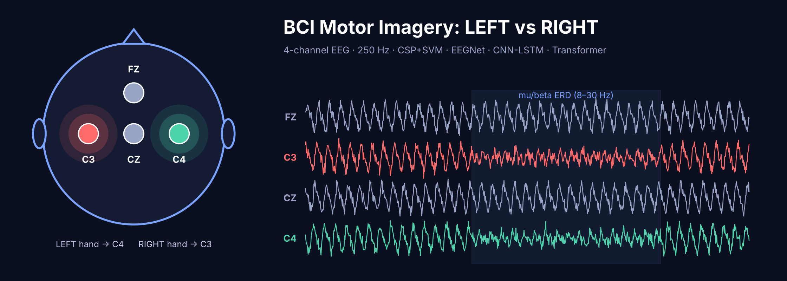
*Illustration of the expected pattern (not real data): imagining a hand movement weakens the mu/beta rhythm over the opposite motor cortex.*

**Question:** Can 4 EEG channels tell whether a person is *imagining* moving the left hand or the right hand?

**Live demo:** https://brain-computer-interface-bci-motor-imagery-classification-kxhn.streamlit.app/

> [!IMPORTANT]
> **Main finding: every model scores at chance.** In session-grouped cross-validation, the mean AUC is 0.466–0.491 (chance = 0.500).
> The labels are the cause, not the models. `labels.csv` has 2400 rows with no file names for 2160 files. In 24 of 36 pairs of byte-identical recordings, the two copies have **opposite** labels.
> The EEG shows no LEFT/RIGHT difference either: 0 of 8 mu/beta tests on C3/C4 reach p < 0.05.
> The recording session explains up to 0.3872 of the mu-power variance. The label explains at most 0.0009.

---

## App screenshots

| Live demo | Model face-off | Why it's a coin flip |
|---|---|---|
| 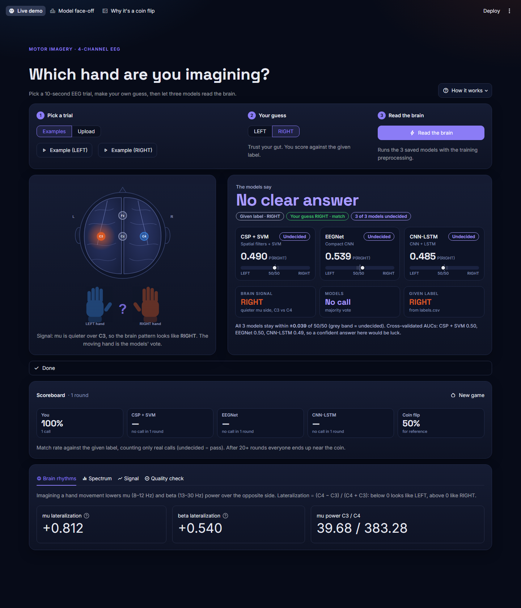 | 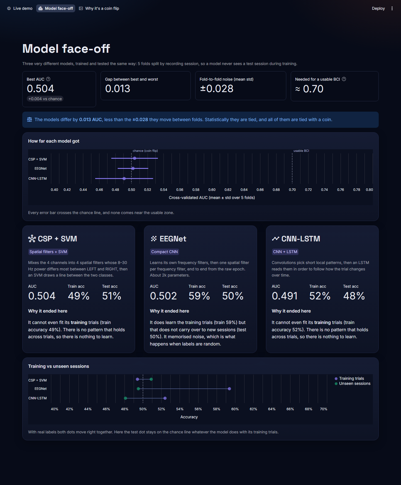 | 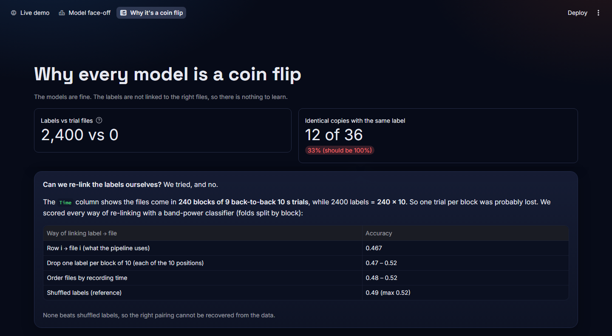 |
| Pick a dataset trial, an example trial, or upload a CSV/Excel file. Every model gives LEFT/RIGHT with P(RIGHT), and a head shows C3/C4 mu power. | AUC with error bars for each model, and training accuracy next to accuracy on unseen sessions. | The label evidence: duplicate pairs with conflicting labels, and the label-to-file pairings we tried. |

| LEFT prediction | RIGHT prediction |
|---|---|
| 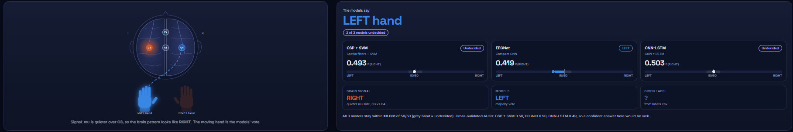 | 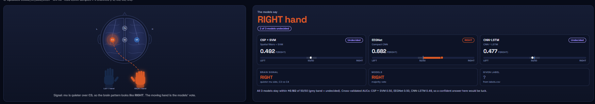 |
| C4 (right motor cortex) lights up and the LEFT hand moves. | C3 (left motor cortex) lights up and the RIGHT hand moves. |

---

## The task

| | |
|---|---|
| **Goal** | Classify each 10 s trial as LEFT- or RIGHT-hand motor imagery. |
| **Data** | 2160 CSV files (`cellula_MI_data_<n>.csv`), each with 2500 samples (10 s at 250 Hz) and a `Time` column. `labels.csv` holds 2400 labels (`LEFT` / `RIGHT`) with **no file names**. |
| **Channels** | FZ, C3, CZ, C4 |
| **After cleaning** | 1831 trials (LEFT 916 / RIGHT 915) from 78 recording sessions |

**The neuroscience.** Imagining a hand movement lowers the power of the **mu (8–12 Hz)** and **beta (13–30 Hz)** rhythms over the motor cortex on the *opposite* side of the brain. This drop is called event-related desynchronization (ERD).

| Imagined hand | Expected ERD over |
|---|---|
| LEFT | **C4** (right hemisphere) |
| RIGHT | **C3** (left hemisphere) |

A working classifier should therefore see C3 vs C4 band-power differences between the two classes.

---

## Pipeline

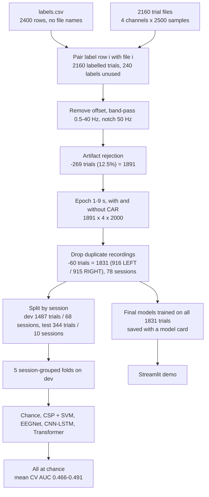

---

## Notebook stages

All numbers come from the saved outputs of [`main_pipeline.ipynb`](main_pipeline.ipynb) unless a row says otherwise.

### 1. Data checks

| What we did | Why | Result |
|---|---|---|
| Matched trial files to `labels.csv` | The label file has no file names | 2160 files numbered 1…N with no gaps; 2400 label rows. Row *i* is paired with file *i*, and 240 labels are unused. |
| Class balance | An imbalance changes which metrics we can trust | LEFT 1082 (50.09%) / RIGHT 1078 (49.91%) |
| Channels, length, missing values | Every trial must have the same shape | `FZ,C3,CZ,C4` in all 2160 files, 2500 rows each, 0 files with NaN |
| Sampling rate | The `Time` column is the only clock | Samples ÷ duration gives a median of 250.27 Hz. The time stamps are irregular (the median step alone gives 416 Hz), so we use 250 Hz × 10 s. |
| Flat and extreme signals | Find broken recordings | 124 trials with >10% repeated values; 118 with extreme peaks; 159 with too-large amplitude |

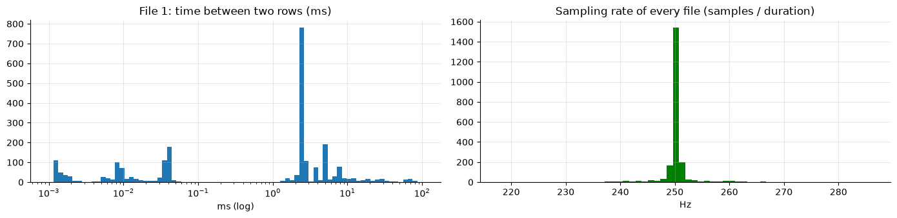

### 2. Signal processing

| What we did | Why | Result |
|---|---|---|
| Removed each channel's offset | Raw values sit around 320,000 | Signal centred at 0 |
| Band-pass 0.5–40 Hz (4th-order Butterworth, zero-phase) + 50 Hz notch | Keep mu/beta; remove drift and mains noise | Median C3/C4 peak-to-peak: raw 1,586 → filtered 197 (×8) |
| Artifact rejection: Q3 + 3×IQR limits on peak-to-peak and std, and >10% flat samples | Remove bad trials with data-driven limits, not hand-tuned ones | Removed 269 of 2160 (12.5%): LEFT 134, RIGHT 135. Not linked to class (chi-square p = 0.97). |
| Epoch 1–9 s, mean removed | No cue marker in the files; the first and last second carry filter edge effects | 1891 × 4 × 2000 |
| Saved versions without and with common average reference (CAR) | CAR over only 4 channels is a weak reference, so we compare both | `epochs_noCAR.npy`, `epochs_CAR.npy` |
| Removed duplicate recordings | Copies would leak between folds, and copies with conflicting labels cannot both be right | 60 trials dropped → **1831** (LEFT 916 / RIGHT 915), 78 sessions |

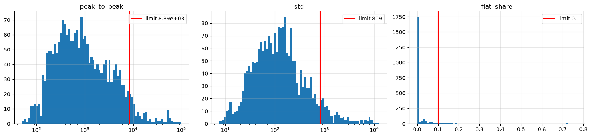


### 3. EDA

| What we did | Why | Result |
|---|---|---|
| PSD, LEFT vs RIGHT, on C3/C4 in mu and beta | ERD should show up as a power difference | **0 of 8** differences are significant (p < 0.05). Largest 0.481 dB (p = 0.195). |
| Log-log PSD | Check the mains frequency | The 50 Hz peak is 11,443×–48,630× its neighbours; nothing at 60 Hz → 50 Hz mains, so the notch is correct |
| Peak mu frequency | Clean motor recordings show a clear mu peak | The most common peak is 7 Hz, the edge of the search range → no clear mu peak |
| Mu power over time | Find a stable window | Edge effects in the first and last second; 1–9 s is stable |
| Lateralization index (C3 vs C4) | ERD should appear on the opposite hemisphere | Cohen's d −0.026 to 0.026; Mann-Whitney p 0.356–0.876 |
| Band power per channel | Look for any channel or band that separates the classes | Largest \|effect size\|: **0.061** (0.2 = small) |


LEFT and RIGHT spectra overlap on C3 and C4.

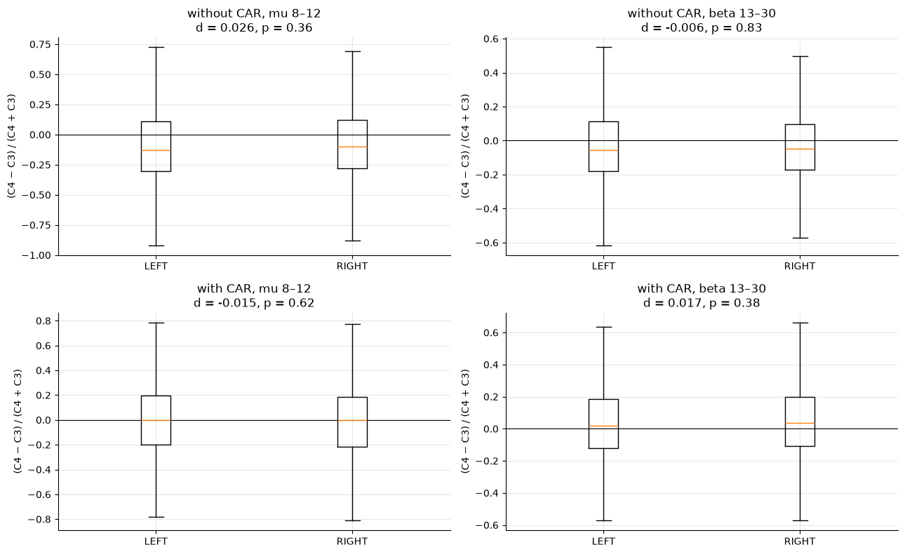
The lateralization index has the same distribution for both classes: no contralateral ERD.

### 4. Data-quality investigation

| What we did | Why | Result |
|---|---|---|
| Recording sessions from `Time` gaps > 60 s | Trials from one session are not independent | **80 sessions over 19.4 days**, all built from 9-trial blocks |
| Session vs label effect (eta², log mu power) | Which explains the signal more: the session or the label? | Session: C3 0.3872, C4 0.2577. Label: C3 0.0007, C4 0.0009. |
| Label order (runs test) | Labels in blocks could leak through file order | p = 0.245 → order looks random |
| Duplicate files (SHA hash) | Identical recordings must carry identical labels | **36 pairs**. Only **12 of 36** share a label (should be 36 of 36). |
| Label shift (−240…+240 rows) | Maybe the labels are just offset | Best shift → 72% agreement; **no shift reaches 100%** |
| Other label-to-file pairings | Try to recover the right pairing | None beats shuffled labels (all 0.47–0.52 accuracy) |

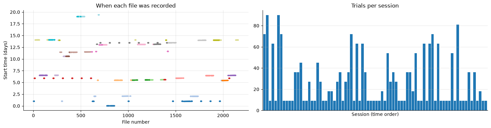
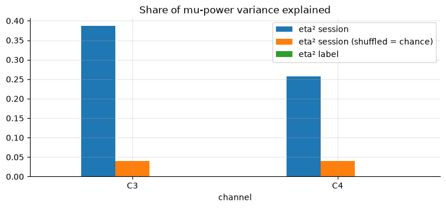
The session explains up to 0.3872 of the mu-power variance; the label explains at most 0.0009.


No shift of the label column makes duplicate pairs agree.

### 5. Features

| What we did | Why | Result |
|---|---|---|
| Split by session (`StratifiedGroupKFold`): held-out test set + 5 folds on dev | No session may appear in both training and test | Test: 344 trials / 10 sessions. Dev: 1487 trials / 68 sessions |
| 18 band-power features (log and relative mu/beta per channel, C3–C4 asymmetry) | Direct measures of ERD | Best single features: AUC 0.475–0.520 |
| CSP, 8–30 Hz, 4 filters | The standard spatial filter for motor imagery | Eigenvalues 0.493–0.508 (0.5 = no discriminative direction) |

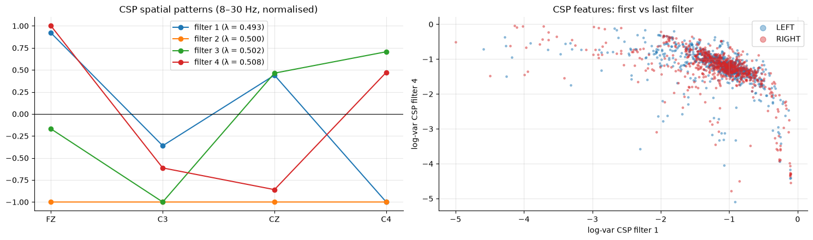

### 6. Models

All models use the same 5 dev folds.

| Model | Setup | Size |
|---|---|---|
| Chance (prior) | `DummyClassifier(strategy="prior")` | — |
| CSP + SVM | CSP 8–30 Hz (4 filters) → `StandardScaler` → `SVC` | — |
| EEGNet | Compact CNN, input decimated to 125 Hz | 2,162 parameters |
| CNN-LSTM | 1-D convolutions → LSTM | 12,690 parameters |
| Transformer | EEG-Conformer style: temporal conv → spatial conv → 3-layer encoder with a `[CLS]` token | 114,210 parameters |

**Sanity check.** On a synthetic copy of the data with textbook ERD added, the Transformer reached AUC 0.736. So the code can learn ERD when it is there.

### 7. Evaluation

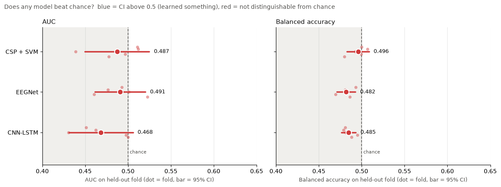

### 8. Deployment

| What we did | Why | Result |
|---|---|---|
| Trained final models on all 1831 trials and saved them with a `model_card.json` | Cross-validation measures models but keeps none | `models/deploy/` |
| Shared preprocessing code in `bci_pipeline.py` | Training and inference must use identical preprocessing | App output == notebook output (max difference 0.0) |
| Tested the app with Streamlit `AppTest` | Prove the demo works end to end | Opens with no errors |
| Live demo (`demo_app/`) on Streamlit Community Cloud | A public demo | CSP + SVM, EEGNet, CNN-LSTM |

---

## Results

### A. Main pipeline: `main_pipeline.ipynb`

Mean ± std over 5 session-grouped dev folds (1487 trials, 68 sessions).

| Model | Accuracy | Balanced acc | F1 | AUC | t-test vs 0.5 (AUC) |
|---|---|---|---|---|---|
| Chance (prior) | 0.503 ± 0.013 | 0.500 ± 0.000 | 0.670 ± 0.012 | 0.500 ± 0.000 | reference |
| CSP + SVM | 0.496 ± 0.014 | 0.496 ± 0.010 | 0.622 ± 0.060 | 0.487 ± 0.030 | p = 0.802 |
| EEGNet | 0.482 ± 0.009 | 0.482 ± 0.009 | 0.501 ± 0.031 | 0.491 ± 0.024 | p = 0.785 |
| CNN-LSTM | 0.484 ± 0.007 | 0.485 ± 0.007 | 0.430 ± 0.173 | 0.468 ± 0.030 | p = 0.961 |
| Transformer | 0.480 ± 0.028 | 0.478 ± 0.029 | 0.419 ± 0.190 | 0.466 ± 0.032 | p = 0.963 |

**Held-out test (Transformer, 344 trials / 10 sessions):** accuracy 0.523, AUC 0.547; binomial p = 0.209 → not better than chance.

### B. Models in the live demo: `BCI_MI_Pipeline.ipynb`

Mean ± std over 5 session-grouped folds on all 1831 trials.

| Model | Accuracy | Balanced acc | AUC | Train acc | Shuffled-label check |
|---|---|---|---|---|---|
| CSP + SVM | 0.509 ± 0.030 | 0.508 ± 0.021 | 0.504 ± 0.029 | 0.494 | 30 shuffles → permutation p = 0.29 |
| EEGNet | 0.495 ± 0.012 | 0.496 ± 0.012 | 0.502 ± 0.019 | 0.594 | Shuffled AUC 0.485 |
| CNN-LSTM | 0.481 ± 0.031 | 0.479 ± 0.030 | 0.491 ± 0.036 | 0.524 | Train acc 0.523 shuffled vs 0.524 real |

> `models/test_metrics.json` and `models/leaderboard.csv` come from early exploration notebooks (random splits, before the duplicate and session checks). Their numbers are not valid.

---

## Why every model is at chance

| Evidence | What it shows |
|---|---|
| 24 of 36 identical recording pairs have opposite labels | The labels do not belong to the files they are paired with |
| 2400 labels, 2160 files, no file names | The label-to-file pairing is a guess |
| No label shift or other pairing beats shuffled labels | The right pairing cannot be recovered from the data |
| 0 of 8 PSD tests significant; largest effect size 0.061 | The EEG shows no LEFT/RIGHT ERD with these labels |
| Session eta² 0.3872 vs label eta² 0.0009 | The signal varies with *when* it was recorded, not with the label |
| Models fit shuffled labels as well as real ones | There is nothing real to learn |
| The Transformer learns injected ERD (AUC 0.736) | The code works; the problem is the labels |

---

## How to run locally

```bash
git clone https://github.com/esraa-elgebaly/Brain-Computer-Interface-BCI-Motor-Imagery-Classification.git
cd Brain-Computer-Interface-BCI-Motor-Imagery-Classification/demo_app
python -m venv .venv
# Windows: .venv\Scripts\activate    macOS/Linux: source .venv/bin/activate
pip install -r requirements.txt
streamlit run app.py
```

Then open http://localhost:8501.

- The example trials and file upload work without the raw dataset. Uploads need the columns `FZ, C3, CZ, C4` and at least 2500 rows.
- To run the full pipeline, put the raw data in `MI_DATA/` and run [`main_pipeline.ipynb`](main_pipeline.ipynb) top to bottom. The data is not in this repo.

---

## Repository structure

```text
.
├── main_pipeline.ipynb        # main notebook: data → deployment
├── BCI_MI_Pipeline.ipynb      # pipeline that produced the live-demo models
├── bci_pipeline.py            # shared preprocessing + inference
├── bci_features.py            # CSP, filter-bank CSP, band-power features
├── demo_app/                  # the live Streamlit demo
│   ├── app.py                 # entry point
│   ├── app_core.py            # loading, brain-rhythm math, brain drawing
│   ├── app_pages/             # demo.py, models.py, data.py
│   ├── models/                # saved models + model_card.json
│   ├── outputs/               # CV results, duplicates, removed trials
│   └── example_trials/        # one LEFT and one RIGHT trial
├── models/deploy/             # final models from main_pipeline.ipynb
├── docs/images/               # figures and app screenshots
└── requirements.txt
```

---

## Limitations

| Limitation | Effect |
|---|---|
| Labels are not linked to files | No model result can be trusted until this is fixed |
| Only 4 electrodes | CAR is weak; spatial filters have little to work with |
| No cue marker in the files | A fixed 1–9 s window is used |
| No subject IDs | CV groups by recording session instead of by subject |
| Small held-out test set (344 trials) | The test score is noisy |

## Next steps

1. Get a label file that names each trial's file, then re-run the notebook. The app picks up new models with no code change.
2. Validate the pipeline on data with trusted labels: BCI Competition IV 2b has C3/Cz/C4 at 250 Hz and the same LEFT vs RIGHT task.
3. Add a shuffled-label test to `main_pipeline.ipynb` for every model.
4. Export the models to ONNX so the app does not need PyTorch.

---

## Team

| Name | GitHub |
|---|---|
| Esraa Elgebaly | [github.com/esraa-elgebaly](https://github.com/esraa-elgebaly) |
| Youssef | [github.com/Youssef57-T](https://github.com/Youssef57-T) |
| dyajaballh8 | [github.com/dyajaballh8](https://github.com/dyajaballh8) |
