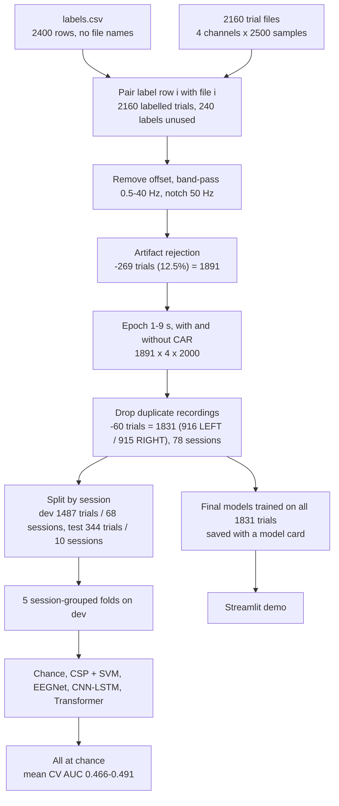
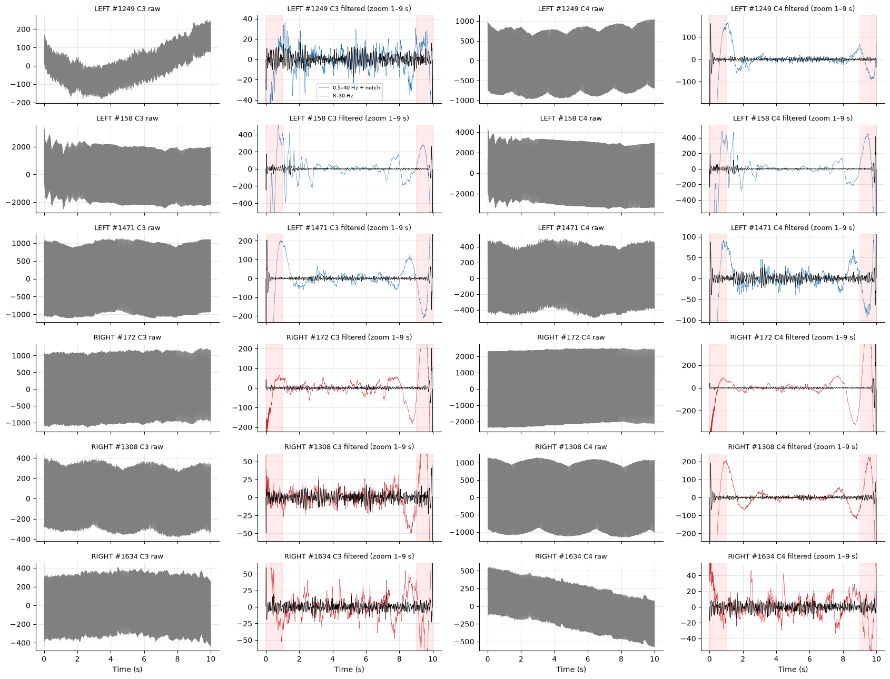
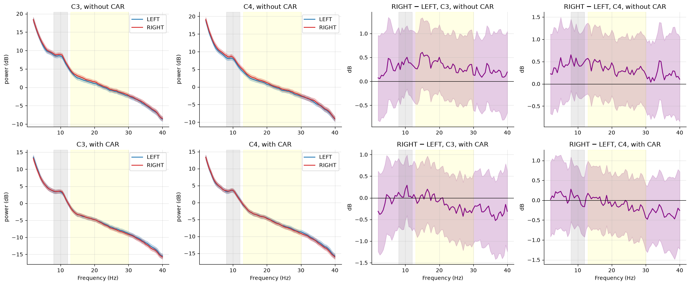
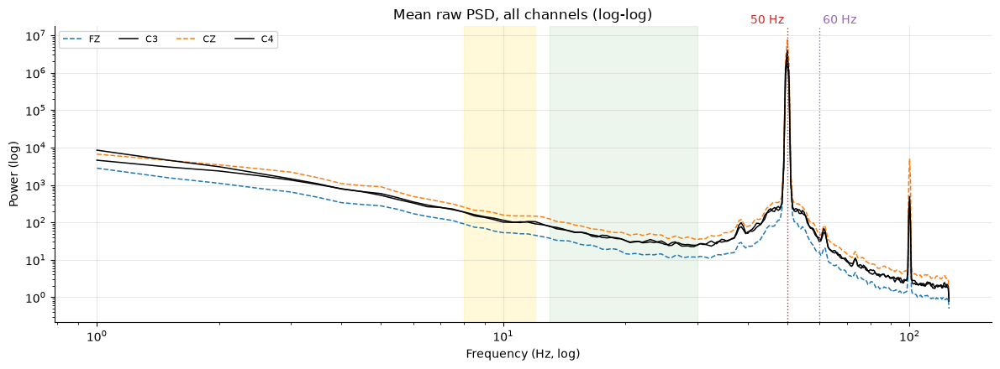
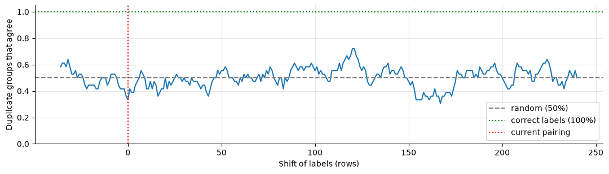

# BCI Motor Imagery Classification: LEFT vs RIGHT hand from 4-channel EEG

[](https://brain-computer-interface-bci-motor-imagery-classification-kxhn.streamlit.app/)

**Question:** Can 4 EEG channels tell whether a person is *imagining* moving the left hand or the right hand?

**Live demo:** https://brain-computer-interface-bci-motor-imagery-classification-kxhn.streamlit.app/

> [!IMPORTANT]
> **Main finding: every model scores at chance.** In session-grouped cross-validation, the mean AUC is 0.466–0.491 (chance = 0.500).
> The labels are the cause, not the models. `labels.csv` has 2400 rows with no file names for 2160 files. In 24 of 36 pairs of byte-identical recordings, the two copies have **opposite** labels.
> The EEG shows no LEFT/RIGHT difference either: 0 of 8 mu/beta tests on C3/C4 reach p < 0.05.
> The recording session explains up to 0.3872 of the mu-power variance. The label explains at most 0.0009.

---

## App screenshots

| Live demo | Model face-off | Why it's a coin flip |
|---|---|---|
|  |  |  |
| Pick a dataset trial, an example trial, or upload a CSV/Excel file. Every model gives LEFT/RIGHT with P(RIGHT), and a head shows C3/C4 mu power. | AUC with error bars for each model, and training accuracy next to accuracy on unseen sessions. | The label evidence: duplicate pairs with conflicting labels, and the label-to-file pairings we tried. |

| LEFT prediction | RIGHT prediction |
|---|---|
|  |  |
| C4 (right motor cortex) lights up and the LEFT hand moves. | C3 (left motor cortex) lights up and the RIGHT hand moves. |

---

## The task

| | |
|---|---|
| **Goal** | Classify each 10 s trial as LEFT- or RIGHT-hand motor imagery. |
| **Data** | 2160 CSV files (`cellula_MI_data_<n>.csv`), each with 2500 samples (10 s at 250 Hz) and a `Time` column. `labels.csv` holds 2400 labels (`LEFT` / `RIGHT`) with **no file names**. |
| **Channels** | FZ, C3, CZ, C4 |
| **After cleaning** | 1831 trials (LEFT 916 / RIGHT 915) from 78 recording sessions |

**The neuroscience.** Imagining a hand movement lowers the power of the **mu (8–12 Hz)** and **beta (13–30 Hz)** rhythms over the motor cortex on the *opposite* side of the brain. This drop is called event-related desynchronization (ERD).

| Imagined hand | Expected ERD over |
|---|---|
| LEFT | **C4** (right hemisphere) |
| RIGHT | **C3** (left hemisphere) |

A working classifier should therefore see C3 vs C4 band-power differences between the two classes.

---

## Pipeline



---

## Notebook stages

All numbers come from the saved outputs of [`main_pipeline.ipynb`](main_pipeline.ipynb) unless a row says otherwise.

### 1. Data checks (sections 1 and 3)

| What we did | Why | Result |
|---|---|---|
| Matched trial files to `labels.csv` | The label file has no file names | 2160 files numbered 1…N with no gaps; 2400 label rows. Row *i* is paired with file *i*, and 240 labels are unused. |
| Class balance | An imbalance changes which metrics we can trust | LEFT 1082 (50.09%) / RIGHT 1078 (49.91%), ratio 1.004 |
| Channels, length, missing values | Every trial must have the same shape | `FZ,C3,CZ,C4` in all 2160 files, 2500 rows each, 0 files with NaN |
| Sampling rate | The `Time` column is the only clock | Samples ÷ duration gives 217.69–286.13 Hz per file (median 250.27). The mean time step gives 250.0 Hz, but the median step gives 416 Hz. The time stamps are irregular, so we use 250 Hz × 10 s. |
| Flat and extreme signals | Find broken recordings | 124 trials with >10% repeated values (same count on every channel); 118 trials with extreme peaks, 159 with too-large amplitude |

### 2. Signal processing (sections 2 and 8)

| What we did | Why | Result |
|---|---|---|
| Removed each channel's offset | Raw values sit around 320,000 | Trial 1 channel means 320,801.7–334,986.3, std 181.4–428.5 |
| Band-pass 0.5–40 Hz (4th-order Butterworth, zero-phase) + 50 Hz notch (Q = 30) | Keep mu/beta; remove drift and mains noise | Median C3/C4 peak-to-peak: raw 1,586 → filtered 197 (×8) |
| Artifact rejection: Q3 + 3×IQR limits on peak-to-peak and std (first and last 1 s skipped), and >10% flat samples | Remove bad trials with data-driven limits, not hand-tuned ones | Limits 8385.04 / 809.16 / 0.1. Removed 269 of 2160 (12.5%): LEFT 134, RIGHT 135. Rejection is not linked to class (chi-square p = 0.97). |
| Epoch 1–9 s, mean removed | The files have no cue marker, and the first and last second carry filter edge effects | 1891 × 4 × 2000 |
| Saved two versions: without and with common average reference (CAR) | CAR over only 4 channels is a weak reference, so we compare both | `epochs_noCAR.npy`, `epochs_CAR.npy`; models in `main_pipeline.ipynb` use the CAR epochs |
| Removed duplicate recordings | Copies would leak between folds, and copies with conflicting labels cannot both be right | Pairs with conflicting labels dropped entirely; pairs with the same label keep one copy. 60 trials dropped → **1831** (LEFT 916 / RIGHT 915), 78 sessions |

### 3. EDA (sections 4–6)

| What we did | Why | Result |
|---|---|---|
| Plotted raw and filtered signals for 3 LEFT + 3 RIGHT trials | See what filtering removes | Drift dominates the raw signal; filtering shrinks it ×8 |
| PSD, LEFT vs RIGHT, on C3/C4 in mu and beta, with and without CAR | ERD should show up as a power difference | **0 of 8** differences are significant (p < 0.05). The largest is 0.481 dB (C4 mu, no CAR, p = 0.195). Only 50% have the expected sign (no CAR). |
| Log-log PSD | Check the mains frequency and the 1/f shape | 1/f slope −1.45 to −1.53. The 50 Hz peak is 11,443.7×–48,630.5× its neighbours; 60 Hz is 0.34–0.41× → 50 Hz mains |
| Peak mu frequency (7–14 Hz search range) | Clean motor recordings show a clear mu peak | The most common peak is 7.0 Hz, the edge of the range (24.5% of trials on C3, 28.0% on C4) → no clear mu peak |
| Mu power over time | Find a stable window | vs the 2–8 s level: +4.64 at 0–0.5 s, +1.19 at 0.5–1 s, +0.13 at 1–2 s, +0.03 at 8–9 s, +1.52 at 9.5–10 s → 1–9 s is stable |
| Lateralization index (C3 vs C4), 1–9 s and 4–9 s windows | ERD should appear on the opposite hemisphere | Cohen's d −0.026 to 0.026; Mann-Whitney p 0.356–0.876 |
| Band power per channel, C3 vs C4 scatter | Look for any channel or band that separates the classes | Largest \|effect size\| across 6.2–6.3: **0.061** (0.2 = small) |
| Decision rule | Decide whether modeling makes sense | *"NO clear LEFT/RIGHT difference → check data quality before modeling"* |

### 4. Data-quality investigation (section 7)

| What we did | Why | Result |
|---|---|---|
| Channel correlation | A shared signal can hide local ERD | Mean off-diagonal r: raw 0.738 (C3–C4 0.709), filtered 0.753, with CAR −0.248 |
| Recording sessions from `Time` gaps > 60 s | Trials from one session are not independent | **80 sessions over 19.4 days**. Every session is a multiple of 9 trials (240 blocks of 9). File order barely follows recording order (Spearman ρ = −0.19). All 80 sessions contain both classes. |
| Session vs label effect (eta², log mu power) | Which explains the signal more: the session or the label? | Session: C3 0.3872, C4 0.2577 (shuffled sessions: 0.0398 / 0.0394). Label: C3 0.0007, C4 0.0009. |
| Label order (runs test) | Labels in blocks could leak through file order | 1108 runs observed vs 1081 expected, z = 1.16, p = 0.245; longest run 9 → order looks random |
| Duplicate files (SHA hash) | Identical recordings must carry identical labels | **36 pairs** (72 files). Only **12 of 36 (33%)** share a label (100% if labels were right); binomial p vs random labels = 0.065. Copies are whole 9-trial blocks with identical timestamps, offset by 243, 558, 648 or 1035 files. |
| Label shift (move all labels by −240…+240 rows) | Maybe the labels are just offset | Best shift 120 → 72% agreement; **no shift reaches 100%** |
| Other label-to-file pairings, scored with a band-power classifier (from `demo_app/app_pages/data.py`) | Try to recover the right pairing | Row *i* → file *i*: 0.467 accuracy. Drop one label per block of 10: 0.47–0.52. Order by recording time: 0.48–0.52. Shuffled labels: 0.49 (max 0.52). None beats shuffled labels. |

### 5. Features (section 9)

| What we did | Why | Result |
|---|---|---|
| Split by session (`StratifiedGroupKFold`): a held-out test set, then 5 folds on dev | No session may appear in both training and test | Test: 344 trials / 10 sessions. Dev: 1487 trials / 68 sessions, folds of 268–330 trials (9–16 sessions), RIGHT share 0.482–0.515 |
| 18 band-power features (`bci_features.BandPower`: log and relative mu/beta power per channel, C3–C4 asymmetry) | Direct measures of ERD | The 8 strongest single features have dev AUC 0.475–0.520 |
| CSP, 8–30 Hz, 4 filters (`bci_features.FilterBankCSP`) | The standard spatial filter for motor imagery | Eigenvalues 0.493–0.508 (at most 0.008 from 0.5 = no discriminative direction); single-feature AUC 0.471–0.512 |

### 6. Models (sections 9 and 10)

All models use the same 5 dev folds and the CAR epochs.

| Model | Setup | Size |
|---|---|---|
| Chance (prior) | `DummyClassifier(strategy="prior")` | — |
| CSP + SVM | CSP 8–30 Hz (4 filters) → `StandardScaler` → `SVC(C=1)` | — |
| EEGNet | Compact CNN, input decimated ×2 to 125 Hz, 40 epochs | 2,162 parameters |
| CNN-LSTM | 1-D convolutions → LSTM | 12,690 parameters |
| Transformer | EEG-Conformer style: temporal conv → spatial conv → pooling → 3-layer encoder (4 heads, d = 64) with a `[CLS]` token. 7 s random crops, AdamW, label smoothing 0.1, early stopping on an inner session split. | 114,210 parameters, 105 tokens + CLS |

**Transformer sanity check (10.4).** We built a synthetic copy of the dev epochs with textbook ERD added (weaker mu on C4 for LEFT, on C3 for RIGHT). The Transformer reached AUC 0.736 (accuracy 0.66) on it. This check tests the code only, not the real labels.

### 7. Evaluation (sections 9 and 10)

| What we did | Why | Result |
|---|---|---|
| Accuracy, balanced accuracy, F1, AUC per fold | Balanced accuracy and AUC are robust to small class shifts | See [Results](#results) |
| 95% CI and one-sided t-test vs 0.5 over the 5 folds | Does any model beat chance? | No model's CI lies above 0.5 (all p ≥ 0.785) |
| Transformer: trained once on all dev trials, scored **once** on the held-out test sessions | An honest final number | Accuracy 0.523, balanced acc 0.532, F1 0.617, AUC 0.547; 180/344 correct, binomial p = 0.209 |

### 8. Deployment (section 11)

| What we did | Why | Result |
|---|---|---|
| Trained all 4 models on all 1831 trials and saved them (`joblib`, `torch.save`) with a `model_card.json` | Cross-validation measures models but keeps none | Done in 230 s → `models/deploy/`. The card stores the config, artifact limits, SHA-256 of `bci_pipeline.py` and `bci_features.py`, CV scores and a data warning. |
| Shared inference code in `bci_pipeline.py` | Training and inference must use identical preprocessing | On all 2160 raw files: artifact flags and epochs identical to the notebook (max abs difference 0.00e+00). |
| Tested the app headless with Streamlit `AppTest` | Prove the demo works end to end | Opens with no errors; both example-trial buttons pass the quality check |
| Live demo (`demo_app/`) on Streamlit Community Cloud | A public demo | Ships the 3 models from [`BCI_MI_Pipeline.ipynb`](BCI_MI_Pipeline.ipynb) (CSP + SVM, EEGNet, CNN-LSTM; default CSP + SVM) |

---

## Figures


The `Time` column is irregular (217.69–286.13 Hz per file), but every file has 2500 rows, so a fixed 250 Hz is the only consistent rate.


Data-driven limits remove 269 trials (12.5%), and they remove them equally from both classes (p = 0.97).


Raw signals are dominated by drift; filtering makes them ×8 smaller and exposes the brain rhythms.


LEFT and RIGHT spectra overlap on C3 and C4: 0 of 8 mu/beta differences are significant.


A huge 50 Hz line and nothing at 60 Hz prove the mains noise is 50 Hz, so the 50 Hz notch is correct.


The C3/C4 lateralization index has the same distribution for both classes (|d| ≤ 0.026): no contralateral ERD.


80 sessions over 19.4 days, all built from 9-trial blocks, so cross-validation must group by session.


The session explains up to 0.3872 of the mu-power variance; the label explains at most 0.0009.


No shift of the label column makes duplicate pairs agree (best 72%), so the labels are not just offset.

---

## Results

### A. Main pipeline: `main_pipeline.ipynb`

Mean ± std over the 5 session-grouped dev folds (1487 trials, 68 sessions). Chance check: one-sided t-test of the 5 fold scores vs 0.5.

| Model | Accuracy | Balanced acc | F1 | AUC | t-test vs 0.5 (AUC / bal. acc) |
|---|---|---|---|---|---|
| Chance (prior) | 0.503 ± 0.013 | 0.500 ± 0.000 | 0.670 ± 0.012 | 0.500 ± 0.000 | reference |
| CSP + SVM | 0.496 ± 0.014 | 0.496 ± 0.010 | 0.622 ± 0.060 | 0.487 ± 0.030 | p = 0.802 / 0.799 |
| EEGNet | 0.482 ± 0.009 | 0.482 ± 0.009 | 0.501 ± 0.031 | 0.491 ± 0.024 | p = 0.785 / 0.995 |
| CNN-LSTM | 0.484 ± 0.007 | 0.485 ± 0.007 | 0.430 ± 0.173 | 0.468 ± 0.030 | p = 0.961 / 0.996 |
| Transformer | 0.480 ± 0.028 | 0.478 ± 0.029 | 0.419 ± 0.190 | 0.466 ± 0.032 | p = 0.963 / 0.917 |

Transformer AUC 95% CI: 0.426–0.505. **Held-out test (Transformer, 344 trials / 10 sessions):** accuracy 0.523, balanced acc 0.532, F1 0.617, AUC 0.547; 180/344 correct, binomial p = 0.209.

### B. Models in the live demo: `BCI_MI_Pipeline.ipynb`

Mean ± std over 5 session-grouped folds on all 1831 trials (`demo_app/outputs/final_results.csv`). Input: epochs without CAR.

| Model | Accuracy | Balanced acc | F1 | AUC | Train acc | Shuffled-label / permutation check |
|---|---|---|---|---|---|---|
| CSP + SVM | 0.509 ± 0.030 | 0.508 ± 0.021 | 0.505 ± 0.179 | 0.504 ± 0.029 | 0.494 | Shuffled AUC 0.494 (0.470–0.525), 30 shuffles → **permutation p = 0.29**; binomial p = 0.242 |
| EEGNet | 0.495 ± 0.012 | 0.496 ± 0.012 | 0.497 ± 0.024 | 0.502 ± 0.019 | 0.594 | Shuffled AUC 0.485 (1 shuffle); train acc 0.554 shuffled vs 0.594 real; binomial p = 0.680 |
| CNN-LSTM | 0.481 ± 0.031 | 0.479 ± 0.030 | 0.457 ± 0.082 | 0.491 ± 0.036 | 0.524 | Shuffled AUC 0.465 (1 shuffle); train acc 0.523 shuffled vs 0.524 real; binomial p = 0.954 |

> Older files `models/test_metrics.json` and `models/leaderboard.csv` come from early exploration notebooks (random splits, before duplicate and session checks) and are not valid results.

---

## Why every model is at chance

| Evidence | What it shows |
|---|---|
| 24 of 36 byte-identical recording pairs have opposite labels | One recording has one true label, so the labels do not belong to the files they are paired with |
| 2400 labels, 2160 files, no file names | The label-to-file pairing is a guess (row *i* → file *i*) |
| No shift of labels (−240…+240) fixes the duplicates; other pairings never beat shuffled labels | The right pairing cannot be recovered from the data |
| 0 of 8 PSD tests significant; largest \|effect size\| 0.061 | The EEG shows no LEFT/RIGHT ERD with these labels |
| Session eta² up to 0.3872 vs label eta² ≤ 0.0009 | The signal varies with *when* it was recorded, not with the label |
| CSP eigenvalues 0.493–0.508 | Not even a spatial filter separates the classes |
| Train accuracy 0.494–0.594, and 0.523 vs 0.524 for CNN-LSTM with shuffled labels (demo pipeline) | The models cannot fit real labels better than random ones |
| Preprocessing reproduces exactly, and the Transformer learns injected ERD (AUC 0.736) | The code works; the problem is the labels |

---

## How to run locally

### The demo app

```bash
git clone https://github.com/esraa-elgebaly/Brain-Computer-Interface-BCI-Motor-Imagery-Classification.git
cd Brain-Computer-Interface-BCI-Motor-Imagery-Classification/demo_app
python -m venv .venv
# Windows: .venv\Scripts\activate    macOS/Linux: source .venv/bin/activate
pip install -r requirements.txt
streamlit run app.py
```

Then open http://localhost:8501.

- The example trials and file upload work without the raw dataset. Uploads need the columns `FZ, C3, CZ, C4` and at least 2500 rows. Excel upload also needs `pip install openpyxl`.
- The *pick a dataset trial* option needs the raw trial files at the path set in `demo_app/config.json` (`data.trial_glob`, `data.labels_csv`).

### The full pipeline

1. `pip install -r requirements.txt` (at the repo root).
2. Put the raw data at `MI_DATA-20261119T122010Z-1-001/MI_DATA/` (`MI/MI CSV/cellula_MI_data_*.csv` and `labels.csv`). The data is not in this repo.
3. Run [`main_pipeline.ipynb`](main_pipeline.ipynb) top to bottom. It writes `outputs/` and `models/`. The Transformer section takes 30+ minutes on a CPU.

---

## Repository structure

```text
.
├── main_pipeline.ipynb        # main notebook: sections 1-11 (data → deployment)
├── BCI_MI_Pipeline.ipynb      # pipeline that produced the live-demo models
├── bci_pipeline.py            # shared inference: read trial → filter → artifact check → CAR + epoch → model input
├── bci_features.py            # CSP, filter-bank CSP, band-power features (sklearn transformers)
├── app.py                     # simple Streamlit app for models/deploy/
├── demo_app/                  # the live Streamlit demo
│   ├── app.py                 # entry point and navigation
│   ├── app_core.py            # cached loading, brain-rhythm math, brain drawing
│   ├── app_pages/             # demo.py, models.py, data.py
│   ├── bci_pipeline.py        # preprocessing + models used by the demo
│   ├── config.json            # rate, filters, epoch window, CV, seed
│   ├── models/                # csp_svm.joblib, eegnet.pt, cnn_lstm.pt, model_card.json
│   ├── outputs/               # CV results, duplicates, removed trials
│   └── example_trials/        # one LEFT and one RIGHT trial
├── models/deploy/             # final models from main_pipeline.ipynb + model_card.json
├── example_trials/            # example trials for app.py
├── docs/images/               # notebook figures
├── docs/screenshots/          # app screenshots
├── 01_*.ipynb – 03_*.ipynb    # earlier exploration notebooks
└── requirements.txt
```

---

## Limitations

| Limitation | Effect |
|---|---|
| Labels are not linked to files | No model result can be trusted until this is fixed |
| Only 4 electrodes | CAR is a weak reference; spatial filters have little to work with |
| No cue marker and no rest period in the files | A fixed 1–9 s window is used, and each epoch is centred on its own mean |
| No subject IDs | CV groups by recording session (gaps > 60 s) instead of by subject |
| Small held-out test set (344 trials, 10 sessions) | The test score is noisy |
| Shuffled-label test not yet in `main_pipeline.ipynb`; only 1 shuffle per deep model in `BCI_MI_Pipeline.ipynb` | Weaker chance evidence for the deep models |
| The Transformer's synthetic-ERD check reached only AUC 0.736 | Its training settings may need tuning |

## Next steps

1. Get a label file that names each trial's file, then re-run the notebook. The app picks up new models and the model card with no code change.
2. Validate the pipeline on data with trusted labels: BCI Competition IV 2b (MOABB `BNCI2014_004`) has C3/Cz/C4 at 250 Hz and the same LEFT vs RIGHT task.
3. Add train accuracy and a shuffled-label test to `main_pipeline.ipynb` for every model.
4. Export the models to ONNX so the app does not need PyTorch.
5. Draw the CSP patterns and EEGNet filters as scalp maps.

---

## Team

| Name | GitHub |
|---|---|
| Esraa Elgebaly | [github.com/esraa-elgebaly](https://github.com/esraa-elgebaly) |
| Youssef | [github.com/Youssef57-T](https://github.com/Youssef57-T) |
| dyajaballh8 | [github.com/dyajaballh8](https://github.com/dyajaballh8) |
